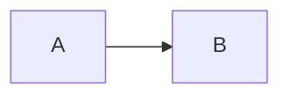

# dbnet-2026

Server-rendered PHP replacement for dbnet-nuxt. It deploys as one directory in the IONOS webroot: PHP renders routes on each request, content and navigation are stored in SQLite, and the admin interface is available on the live site at `/admin/`.

## Requirements

- PHP 8.1+ with PDO SQLite (`pdo_sqlite`)
- Apache with `.htaccess` overrides enabled (`mod_rewrite` and `mod_authz_core`)
- A writable `storage/` directory

The SQLite database is `storage/dbnet.sqlite`, inside the deploy folder as requested. The root and storage `.htaccess` files deny direct web requests to it. Keep those access rules deployed, and confirm the host honors them before placing real data in the folder.

## First use

1. Copy the full project into the webroot, including hidden `.htaccess` files.
2. Ensure PHP can write to `storage/`. The app creates the SQLite database and current schema automatically. To start from a missing or empty SQLite file, create the two required pages:

   ```sh
   php bin/initialize.php
   ```

   This creates only Home (`/`) and Archive (`/archive/`), with no imported content or page hierarchy. Archive is visible in the navbar and is the canonical home for all pool items. Skip this if deploying an already-populated database. Repeated runs leave existing pages untouched, and normal requests never recreate deleted pages.
3. Create an administrator from the webroot command line:

   ```sh
   php bin/create-admin.php YOUR_USERNAME
   ```

   Passwords are stored with PHP's password hashing. Use at least 12 characters.
4. Visit `/admin/login` on the live site to add or edit pages and pool items.
Edit or add pages in the admin; a page's parent and URL segment define its URL, while its optional navigation text is independent of its page title. Parent changes affect descendant URLs, so check existing links when rearranging pages.

The one-time importers, original page-tree seeds, asset-path migrations, and old-schema upgrades have been removed. Existing installations must already use the current schema and asset paths. The working database has completed those migrations; keep it intact. Stored URL aliases and content-tag rendering remain supported because existing content uses them.

## Content and pool items

Pages and pool items are separate records. Pages form the URL hierarchy; each page's pool tag filter selects items with that tag, with no explicit membership assignments. Matching items are available beneath that page's URL and at `/archive/{slug}.html`. Untagged pages have no default items; Archive always includes all items. Explicit `pool-list tag="..."` filters override the page filter, while `pool-list page="..."` uses the referenced page's tag. Previous/next links follow the tag-filtered list context in which the item was opened. Tag-filtered list links preserve that context with a `list` query parameter when needed.

Previous/next controls use the original stacked circular arrows in the left content gutter, with faded non-interactive arrows at list boundaries. On narrow screens they sit side by side above the body to avoid clipping.

On individual pool items, Left/Right arrow keys navigate to the previous/next item when focus is on the page rather than a control. Swiping right/left over the item also navigates, with a threshold greater than 100px and horizontal movement dominating vertical movement. Links, form controls, editable text, code blocks, open dialogs, and multi-touch gestures do not trigger swipe navigation. These shortcuts use the rendered previous/next URLs, preserving list context and stopping at list boundaries; ordinary links still work without JavaScript.

Pool item types and their fields are declared in `app/Types.php`; the shared editor renders declared fields automatically. Rendering templates are selected through the same type registry, without changes to the router.

### Editing layouts and item templates

PHP templates live under `templates/`:

- `layout.php`, `partials/`: document shell, navigation, auth controls, notices, and footer.
- `page.php`, `not-found.php`: ordinary page layouts.
- `pool/article/`, `pool/photo/`, `pool/project/`: independent `detail.php`, `list.php`, `summary.php`, and `image.php` layouts for each item type.
- `pool/navigation.php`: shared previous/next controls.
- `pool/container.php`: list wrapper (the image view uses `imagegrid`; other views use `pool-list`).
- `content/`: footnotes, code blocks, and special-tag links.
- `feeds/`: RSS and XML sitemap layouts.
- `admin/`: login, dashboard, editor wrappers/dialogs, contextual controls, and page/pool forms.

`Template::render('pool/project/summary', $variables)` loads `templates/pool/project/summary.php` with explicit local variables. Missing files and invalid template names throw errors; request parameters cannot select arbitrary filesystem paths. Templates are protected from direct web access, and `deploy.sh` includes them.

Each item type explicitly declares its own views in the `templates` map in `Types::all()`; there are no inherited shared defaults. Initially each has `detail`, `list`, `summary`, and `image`, with the same appearance but separate files. Editing a Project template does not change Articles or Photos. To add a Project-only `card` option, create `templates/pool/project/card.php` and add it only to the Project map:

```php
'project' => [
    'label' => 'Project',
    'fields' => [
        'url' => ['label' => 'URL', 'type' => 'url'],
        'github_url' => ['label' => 'GithubURL', 'type' => 'url'],
    ],
    'templates' => [
        'detail' => 'pool/project/detail',
        'list' => 'pool/project/list',
        'summary' => 'pool/project/summary',
        'image' => 'pool/project/image',
        'card' => 'pool/project/card',
    ],
],
```

Then use `<pool-list tag="project" type="card"></pool-list>`. Tags select items, not item types, so ensure the selected items are Projects when using a Project-only option. `detail` is reserved for full item pages, not pool lists. A list view must be available for every item type selected by that list; an unsupported view raises an explicit error instead of silently choosing another layout. Remove a map entry to disable a view for that type; keep `detail` available for full item pages. To offer a new view for other types, register it in their maps as well.

The list wrapper (`pool/container.php`) and previous/next controls (`pool/navigation.php`) remain shared. For a Project-only card wrapper, branch on `$view === 'card'` in the container; existing list views remain unchanged.

Image-grid titles animate open below the thumbnail on hover or keyboard focus, and remain visible on touch devices. Reveals start immediately; collapse waits 400ms so scanning across a row does not make the grid bounce. Captions wrap to their full height in normal document flow, moving subsequent rows down instead of overlapping them. Reduced-motion preferences disable the animation. Items without images always show their title. Each link has the full title as its accessible name.

List-entry templates receive `$item` (including raw `fields`), `$href` (with list context), `$date`, `$image`, `$thumbnail`, `$summary`, `$view`, `$contextPage`, and `$attributes` (the parsed pool-list attributes). Full-item templates receive `$item`, `$contextPage`, `$date`, `$image`, `$fields` (field definitions), `$body` (rendered HTML), `$previousUrl`, and `$nextUrl`. Data selection, sorting, limits, and URL generation remain outside templates.

Escape plain values with `Content::escape()` (or `h()` in site/admin templates). Only already-rendered HTML such as `$body`, `$entries`, and editor `$form` should be emitted directly. Templates are trusted developer code, not editable content. Markdown parsing still generates its basic paragraph/list/inline markup in `Content.php`.

Available types are Article (no extra fields), Photo (camera metadata), and Project (optional URL and GithubURL fields). Project URLs are stored with the item's fields and displayed with its metadata. Choosing Project does not automatically add the `project` tag; tags still control page listing.

### Pool authoring

Use **Admin** at the top right to sign in and return to the page you were browsing. Signed-in visitors see **Edit page** and **Add pool item** on pages and **Edit pool item** on individual items. These open in-page modals; Cancel or Escape dismisses them and discards unsaved edits. Page editing uses the same fields as the standalone editor; saving returns to the page's updated URL and deleting returns to its parent (or Home). **Manage pages/site** remains available for adding pages and managing the hierarchy. Both editors have standalone links as a no-JavaScript fallback.

New items default to Markdown and inherit the current page and ancestor tags. The editor offers title-to-slug generation until the slug is edited manually, separate tag fields with existing-tag suggestions, image and thumbnail-size previews, and a **Fix HTML** action that normalizes markup using the browser's HTML parser. Smart quotes are applied on save without changing HTML attributes or code blocks. Fields for the selected item type appear directly below the type selector, before Format and Body. Save returns to the saved item, preserving list query context where applicable; Delete returns to its containing page. The thumbnail preview shows a cropped view, not a separately generated thumbnail file.

The same editor works as a standalone form without JavaScript. Validation errors preserve text fields in a retry form; reselect any file upload before retrying.

Content supports HTML and a small Markdown subset (headings, paragraphs, lists, emphasis, links, and inline code). Markdown also accepts trusted inline HTML, such as `<a href="...">links</a>` and `<em>emphasis</em>`; HTML inside backticks is displayed literally. As with HTML-format bodies, only trusted administrators should author this markup. Automatically generated list summaries remain escaped plain-text excerpts. Legacy `<highlightjs>` blocks are rendered as server-side code blocks, and `<router-link>` becomes a normal link.

Fenced code blocks support backticks or tildes and an optional language. Use `mermaid` as the language to render a diagram:

````markdown

````

Mermaid 12.2.0 is self-hosted under `assets/vendor/mermaid/` with its MIT license; no CDN or external rendering service is used. `assets/diagrams.js` loads the bundle only when a diagram is present and renders in strict security mode. HTML content can also use `<pre class="mermaid">...</pre>` (HTML-escape the diagram source), `<pre><code class="language-mermaid">...</code></pre>`, or `<highlightjs language="mermaid">...</highlightjs>`. Without JavaScript the source remains readable; load/syntax failures display an error and preserve the source. Other fenced languages render as escaped code, not executable HTML. To update Mermaid, replace the vendored bundle and license together from an official release and recheck diagrams.

Special content tags:

```html
<pool-list tag="blog,geek" type="summary" sort="desc" limit="10"></pool-list>
<pool-list page="photos" type="image"></pool-list>
<footnote>A numbered note shown in a floating panel beside its reference.</footnote>
```

`pool-list` supports `tag` (comma-separated OR filter), `page` (page ID), `type` (`list`, `summary`, `image`), `sort` (`asc` or `desc`), `limit` (count or `[start,end]`), and `path` (internal URL prefix override). Filtered output is rendered by PHP as part of the initial response.

Click or tap a numbered footnote reference (or activate it with Enter) to open its floating panel. Panels stay within the viewport, reposition on scroll/resize, and close using Close, Escape, another footnote, or a click outside. Pool-item navigation shortcuts are paused while a footnote is open. Without JavaScript or browser Popover API support, references link to ordinary endnotes instead.

Tagged pages (and Archive) get an automatic list only when their body has no explicit `pool-list` or `pool_list` tag. Embedded lists control their own placement and filtering without an extra list being appended.

## URLs and deployment

Page paths are stored in the editable hierarchy; fresh setup does not recreate the original site's tree. Each pool item receives its archive URL plus a URL under each page with a matching tag filter. Keep all `.htaccess` files and the `storage/` folder in the deployed directory. Uploads accept JPEG, PNG, GIF, and WebP files up to 12 MB and use generated filenames.

### Asset locations

- `assets/`: framework CSS, JavaScript, logo, feed icons, fallback images, and favicon files.
- `content/`: content media, with `pool/` for item images/uploads, `img/` for inline and page images, `supersize/` for large legacy images, and `70faces-cover.gif`.

Use `/assets/` and `/content/` URLs directly; redirects from the former asset locations have been removed. Keep `content/.htaccess` to prevent script execution throughout the media tree.

RSS endpoints are rendered dynamically at `/rss.xml`, `/rss-blog.xml`, `/rss-photos.xml`, and `/rss-geek.xml`. Sitemap endpoints are `/sitemap.xml` and `/sitemap.txt`.

### Development and code deployment

```sh
./dev.sh
```

Opens the development server at `http://127.0.0.1:8080`; stop it with Ctrl+C. Override the address with `HOST` and `PORT`, for example `PORT=8081 ./dev.sh`. The script works from any working directory.

```sh
cp .env.example .env
# Set DEPLOY_TARGET in .env to your SSH destination.
./deploy.sh --dry-run
./deploy.sh
```

Deployment uses rsync over SSH to `DEPLOY_TARGET` from the project's local `.env`, for example `DEPLOY_TARGET='user@host:directory'`. An environment variable overrides the file, e.g. `DEPLOY_TARGET=user@host:directory ./deploy.sh --dry-run`. A missing or empty target is an error. The `.env` file is sourced as trusted Bash configuration, so keep it local and do not load untrusted files. It is ignored by Git and excluded from deployment; `.env.example` contains only a placeholder.

The script shows a dry run and requires confirmation before uploading. It deploys application code, framework assets, access-protection files, and the initialization and admin-account CLIs. Local environment files, development scripts, and documentation are not uploaded.

**Code deployment never uploads SQLite files, storage data, or content media, and never deletes remote files.** Only protection files are uploaded within `content/`. Production content, accounts, and uploaded images are preserved. The app creates missing tables and indexes but no longer upgrades old table layouts. Removed code files (including old import/migration tools) must be cleaned up separately on previously deployed servers after review.

For the first deployment only, transfer the populated database as a consistent SQLite backup and copy `content/` separately, including hidden protection files. Content media changes must also be transferred separately in subsequent deployments. This is intentionally not automated by `deploy.sh`. Subsequent code deployments must not replace the live database with the local copy. SSH access and rsync on both machines are required.

## Local checks

```sh
php -l index.php
php -l app/Database.php
php -l app/Content.php
php -l app/Types.php
php -l bin/create-admin.php
php -l bin/initialize.php
php -l bin/dev-router.php
php -S 127.0.0.1:8080 -t . bin/dev-router.php
```
